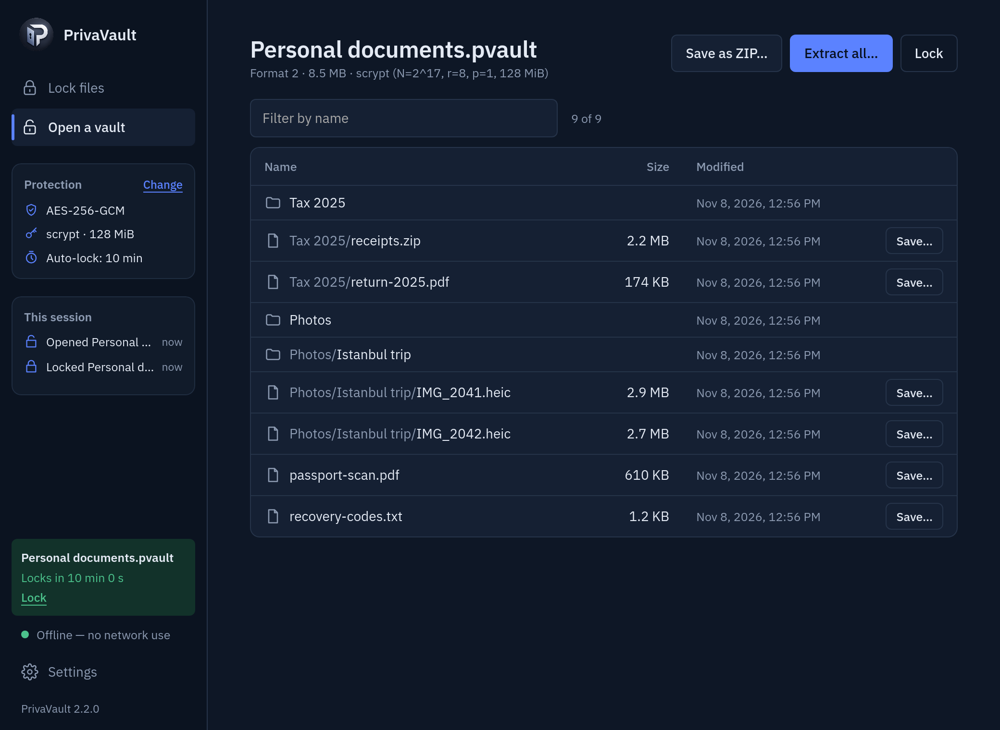
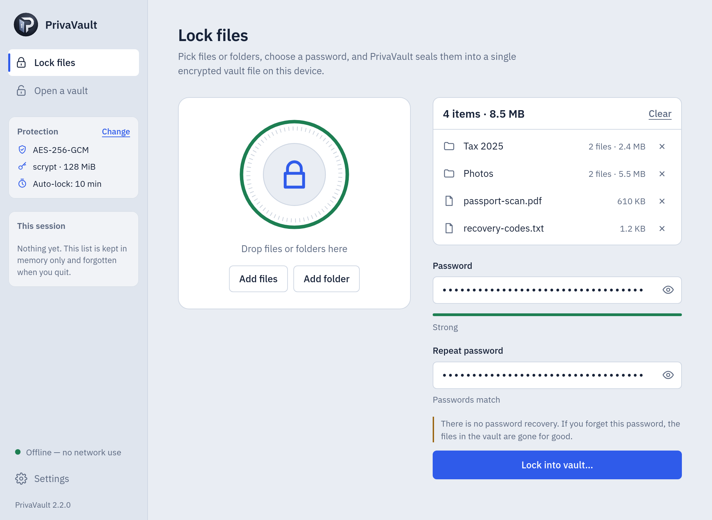
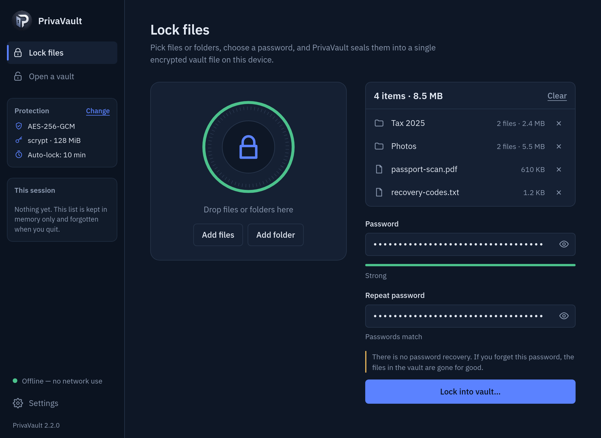
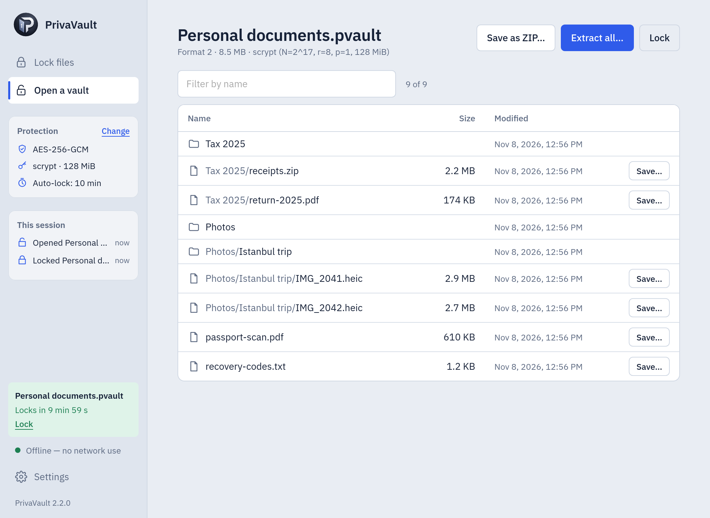

<div align="center">
  
  <h1>PrivaVault</h1>
  <p><b>Offline file encryption for Linux and Windows.</b><br>
  Lock files and folders into a password-protected vault on your own computer.<br>
  No account, no cloud, no telemetry.</p>
  <p>
    <a href="https://github.com/TNFX1/PrivaVault/releases"></a>
    <a href="https://github.com/TNFX1/PrivaVault/actions/workflows/build.yml"></a>
    
    <a href="LICENSE"></a>
  </p>
  <p>
    <a href="#install">Install</a> ·
    <a href="#how-your-files-are-protected">Security</a> ·
    <a href="#build-from-source">Build</a> ·
    <a href="#faq">FAQ</a> ·
    <a href="#türkçe">Türkçe</a>
  </p>
</div>

<p align="center"></p>

## What it does

**Lock files.** Pick files and folders, or drag them onto the window. Choose a password, and PrivaVault
writes everything into one encrypted `.pvault` file. Your originals stay where they are.

**Open a vault.** Unlocking shows the contents straight away, without decrypting everything first. Save
a single file, extract the whole vault into a new folder, or export a plain ZIP.

**See how you're protected.** The sidebar sums up the cipher, the password-protection strength and the
auto-lock time, and lists what you locked, opened and extracted in this session. That list is kept in
memory only and forgotten when you quit.

**Stay offline.** Nothing leaves your computer. The sidebar always shows the network status. The only
optional request is an update check, and it stays off until you turn it on or press *Check now*.

**Update in one click.** When a new version is found, *Update now* downloads it, checks it against
PrivaVault's signature and installs it (Windows installer, AppImage, `.deb`, `.rpm` and the Arch
package). A modified package is refused before anything is installed.

**Open your 1.x vaults.** Every vault made by PrivaVault 1.x opens in 2.0.

| Light | Dark |
| --- | --- |
|  |  |
|  |  |

The theme follows your system, or you can pick light or dark in Settings. The interface is available in
English and Turkish. Keyboard shortcuts: <kbd>Ctrl</kbd>+<kbd>N</kbd> lock files, <kbd>Ctrl</kbd>+<kbd>O</kbd>
open a vault, <kbd>Ctrl</kbd>+<kbd>L</kbd> lock the open vault, <kbd>Ctrl</kbd>+<kbd>,</kbd> settings.

## How your files are protected

| | |
| --- | --- |
| **Password → key** | scrypt with 128 MiB of memory by default (up to 512 MiB). Each password guess costs an attacker that much memory and time. |
| **Encryption** | AES-256-GCM in authenticated 64 KiB chunks (the STREAM construction). Each chunk is verified *before* any of it is written to disk. |
| **Tampering** | Edited, reordered, truncated or extended vaults are detected. A damaged vault releases no data. |
| **No leftovers** | Nothing decrypted goes to a temp folder. Unfinished outputs are removed if something fails or you cancel. |
| **Hostile vaults** | File names like `../../.bashrc` or absolute paths are shown, marked and never extracted. Names are always displayed as plain text. |
| **Memory** | Keys are wiped when you lock the vault, when it auto-locks after 10 idle minutes, or when you quit. |

There is **no password recovery**. If you lose the password, nobody can open the vault, including the
developers.

PrivaVault uses established, reviewed primitives from the RustCrypto project and invents no cryptography.
It has **not** had an independent security audit. The threat model, design rationale and known
limitations are in [docs/SECURITY_AUDIT.md](docs/SECURITY_AUDIT.md).

### What changed from 1.x

| | 1.x (Electron) | 2.0 (Tauri + Rust) |
| --- | --- | --- |
| Platforms | Windows | Linux (Wayland/KDE, GNOME, X11) and Windows |
| Key derivation | PBKDF2, 100k iterations | scrypt, 128–512 MiB |
| Integrity check | after decrypting everything to `/tmp` | per chunk, before anything is written |
| Listing a vault | full decrypt to a temp file | instant (only the encrypted index is read) |
| Network | GitHub request on every start, CDN script | none unless you enable the update check |
| Download size | ~100 MB | ~4 MB (.deb), ~8 MB binary |

## Install

| System | Get it | Guide |
| --- | --- | --- |
| Arch Linux, CachyOS, Manjaro | `privavault-…-x86_64.pkg.tar.zst` from [Releases](https://github.com/TNFX1/PrivaVault/releases), then in that folder `sudo pacman -U ./privavault-*.pkg.tar.zst` | [Linux](docs/LINUX_SETUP.md) |
| Debian, Ubuntu 22.04+ | `.deb` from [Releases](https://github.com/TNFX1/PrivaVault/releases) | [Linux](docs/LINUX_SETUP.md) |
| Fedora, openSUSE | `.rpm` from Releases | [Linux](docs/LINUX_SETUP.md) |
| Any Linux | `.AppImage` from Releases | [Linux](docs/LINUX_SETUP.md) |
| Windows 10 / 11 | `PrivaVault_x64-setup.exe` (installer) or `PrivaVault-Portable.exe` | [Windows](docs/WINDOWS_SETUP.md) |

To remove PrivaVault, see the *Uninstall* section of the
[Linux](docs/LINUX_SETUP.md#uninstall) or [Windows](docs/WINDOWS_SETUP.md#uninstall) guide — your vaults
are never deleted.

On Linux, `.pvault` files open from your file manager, and a second double-click goes to the window
that's already running. File dialogs are your desktop's own (through the XDG portal).

## Performance

Measured on the development machine (x86-64, NVMe, release build), including disk writes and `fsync`:

| Operation | Result |
| --- | --- |
| Encrypt 1 GiB | 1.63 s (≈ 630 MiB/s) |
| Decrypt 1 GiB | 1.56 s (≈ 660 MiB/s) |
| Unlock (scrypt, Standard) | ≈ 0.3 s |

Memory use stays flat regardless of file size. Reproduce with
`cargo run --release -p privavault-core --example bench -- 1024`.

## Build from source

```bash
git clone https://github.com/TNFX1/PrivaVault.git && cd PrivaVault
cargo run -p privavault          # start the app (debug build)
```

On Linux you need the WebKitGTK 4.1 development files (Arch: `webkit2gtk-4.1`; Debian/Ubuntu:
`libwebkit2gtk-4.1-dev`). Release bundles, Windows requirements and packaging are covered in
[docs/BUILDING.md](docs/BUILDING.md).

### Tests

```bash
cargo test --workspace           # 42 tests: crypto, both vault formats, tampering, paths, settings
node --test tests/ui/ui.test.js             # UI: translations, CSP rules, XSS regression
python3 tests/gui/e2e.py         # 40 end-to-end checks against the real app window (Linux desktop)
```

`tests/gui/update_e2e.py` checks one-click updates against a local fake release (a tampered package
must be refused), and `tests/gui/screenshots.py` regenerates the screenshots in this README.

The v1 compatibility tests use vaults produced by the original 1.4.0 JavaScript code
([tools/v1-fixtures](tools/v1-fixtures)). CI runs the Rust and UI tests on Ubuntu and Windows.

## Project layout

```
crates/privavault-core   vault formats, encryption, safe extraction (Rust library, no GUI)
src-tauri                desktop app: commands, settings, platform integration (Tauri 2)
ui                       interface: HTML, CSS, JS, bundled font (no network, strict CSP)
packaging                Linux desktop entry, MIME type, AppStream metadata, Arch PKGBUILD
tests                    UI and end-to-end GUI tests
docs                     architecture, security audit, setup and build guides
```

Further reading: [Architecture](docs/ARCHITECTURE.md) · [Project audit](docs/PROJECT_AUDIT.md) ·
[Changelog](docs/CHANGELOG.md)

## FAQ

**I forgot my password. Can it be reset?**
No. There is no backdoor and no recovery key. Keep the password in a password manager.

**Can PrivaVault 1.x open vaults made by 2.0?**
No. 2.0 writes a stronger format, and it opens both.

**Does locking delete my original files?**
No. Delete them yourself once the vault is stored safely. On SSDs and copy-on-write filesystems such as
Btrfs, deleting a file does not erase it from the disk. Full-disk encryption covers that case.

**Is there a size limit?**
No practical one. Files are processed in small chunks with constant memory use.

**Does it work on Wayland?**
Yes, natively. That includes KDE Plasma (window icon, portal dialogs, notifications) and NVIDIA GPUs,
where a known WebKitGTK rendering issue is worked around automatically.

## Türkçe

PrivaVault, dosya ve klasörlerinizi kendi bilgisayarınızda parolayla korunan tek bir kasa dosyasına
şifreleyen, tamamen çevrimdışı bir uygulamadır. Hesap, bulut ve telemetri yoktur. Linux (KDE Plasma ve
Wayland dahil) ile Windows'ta çalışır. Arayüz Türkçedir; tema sisteme uyar ya da Ayarlar'dan açık veya
koyu seçilebilir.

* **Dosyaları kilitle:** Dosya ve klasörleri seçin ya da pencereye sürükleyin, parola belirleyin. Orijinal
  dosyalarınıza dokunulmaz.
* **Kasa aç:** İçerik anında listelenir. Tek bir dosyayı kaydedebilir, hepsini yeni bir klasöre çıkarabilir
  veya ZIP olarak kaydedebilirsiniz.
* **Koruma:** scrypt (128–512 MiB) ve kimliği doğrulanmış 64 KiB parçalarda AES-256-GCM. Her parça diske
  yazılmadan önce doğrulanır.
* **Parola kurtarma yoktur.** Parolayı unutursanız kasa hiç kimse tarafından açılamaz.
* **Kenar çubuğu:** Şifreleme, parola koruması ve otomatik kilit özeti; bu oturumda kilitlediğiniz, açtığınız
  ve çıkardığınız dosyaların listesi (yalnızca bellekte tutulur, çıkışta unutulur).
* **Tek tıkla güncelleme:** Güncelleme denetimi varsayılan olarak kapalıdır. Yeni sürüm bulunduğunda
  *Şimdi güncelle* paketi indirir, PrivaVault imzasıyla doğrular ve kurar.
* 1.x ile oluşturulan kasalar 2.0'da açılır.

Kurulum için yukarıdaki [Install](#install) tablosuna, ayrıntılar için `docs/` klasörüne bakın.

## License

MIT, see [LICENSE](LICENSE). The bundled IBM Plex Sans font is licensed under the SIL Open Font
License ([ui/fonts/LICENSE-OFL.txt](ui/fonts/LICENSE-OFL.txt)).

*Provided as is, without warranty. Keep backups of important files, and keep your passwords safe.*
